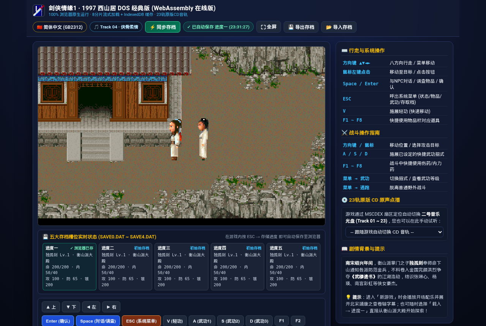

# 剑侠情缘1（1997 西山居 DOS 经典版）— WebAssembly 在线网页版

- **在线试玩 (GitHub Pages)**：[https://kunruiw1991.github.io/jxqy1-online/](https://kunruiw1991.github.io/jxqy1-online/)
- **DOS 硬盘整理版与原始镜像仓库**：[https://github.com/kunruiw1991/jxqy1-dos](https://github.com/kunruiw1991/jxqy1-dos)

## 核心特性

1. **8 分片并行流式加载 + SHA-256 完整性校验 + `IndexedDB` 持久化缓存**
   - 核心游戏数据包（`14.40 MB` 压缩 / `46.13 MB` 解压，含 `412` 个原始游戏文件与 `NPB.DAT`/`NPC.DAT`/`MAP.DAT`/`BLK.DAT`）切分为 8 个 HTTP 二进制分片（`chunks/jxqy1_data.part00.bin` ~ `part07.bin`，单分片约 `1.8 MB`）。
   - 首次打开并行流式下载并逐分片校验 `SHA-256`（`chunks/manifest.json`），重组后写入浏览器 `IndexedDB`（`jxqy1_cache_db`）；二次访问直接从本地 `IndexedDB` 秒开（`0 MB` 网络流量）。

2. **解决 16 位实模式 EXEPACK 64KB 段回绕与 DOSBox Asyncify 兼容性**
   - 原始 `MAIN.EXE` 为 16 位实模式压缩程序，直接加载在低 64KB 内存段会触发 `Illegal GRP4 Call`；而单行执行 `loadfix main` 会因 `LOADFIX::Run()` 在调用栈内嵌套 `DOS_Shell::Execute()` 导致 Emscripten `ASYNCIFY_WHITELIST` 栈回溯 `RuntimeError: unreachable`。
   - 本网页版通过独立行执行 `loadfix` 预留低端 64KB 内存段后再启动 `TITLE.EXE` / `MAIN.EXE`，并在 `wdosbox.js` 与 `emulators.js` 中修复了 WebAssembly 内存动态扩容（`wasmMemory.grow`）后 `sharedMemory` `ArrayBuffer` 脱钩导致的画面停止刷新问题。

3. **0 内存开销虚拟二号音乐光盘 (`AudioCD.bin`) + 23 轨原版 CD 音轨流式同步**
   - 针对游戏启动与切换场景时的 MSCDEX 二号音乐光盘校验（避免弹出 `请插入二号碟！` 并省去 `675 MB` 原始 `AudioCD.bin` 下载），在 `wdosbox.js` 的虚拟文件系统（`MEMFS`）中构建了 `0 MB` 内存占用的虚拟节点 `/home/web_user/CD/AudioCD.bin`（`usedBytes = 675,020,256`）。
   - 实时拦截 MSCDEX 扇区读取请求（`sector = Math.floor(position / 2352)`），对照 `AudioCD.cue` 的 23 轨扇区索引表，自动流式播放对应的原版 Ogg Vorbis 音轨（`cd/Track01.ogg` ~ `cd/Track23.ogg`），同时支持在右侧面板手动点播任意曲目。

4. **启动前配置面板 (`GAME.CFG`) 与新游戏黑屏等待优化**
   - 启动前可自由选择 **简体中文 (`HZK16` + `ASC16`)** 或 **繁体中文 (`HZF` + `ASCF16`)** 字库，以及 **直接进入主菜单 (`MAIN.EXE`)** 或 **播放 1997 西山居水墨剑舞片头动画 (`TITLE.EXE`)**。
   - 在内存中将 `MAIN.EXE` 开新游戏时的黑屏等待计时（原始 `180` ticks ≈ 10 秒纯黑屏等待）缩短为 `24` ticks（≈ 1.3 秒），点击「新游戏」即可迅速展现靖康之变开篇字幕。

5. **五大存档槽位 (`SAVE0.DAT` ~ `SAVE4.DAT`) 实时解析与 `IndexedDB` 自动云端同步**
   - 拦截 `Module.FS.close` 文件关闭事件：玩家在游戏内执行「存储进度」的瞬间，自动将对应的 `SAVE0.DAT` ~ `SAVE4.DAT` 持久化至浏览器 `IndexedDB`。
   - 画面下方实时解析并展示 5 个存档槽的角色姓名、等级、所在地图、生命/内力、攻防与银两，并支持一键打包导出 `.zip` 或导入外部 `.dat` / `.zip` 存档。

## 操作指南

| 按键 / 操作 | 功能说明 |
| --- | --- |
| `方向键 ▲▼◄►` / `鼠标左键` | 角色八方向行走 / 菜单光标移动 / 点击界面按钮 |
| `Space` / `Enter` | 与 NPC 对话 / 调查场景物品 / 菜单确认 |
| `ESC` / `~` (`` ` ``) | 呼出系统菜单 / 取消（兼容无 Esc 键的 iPad 键盘，支持中英文输入法下的 `` ` ``、`~`、`·`、`～`） |
| `V` | 施展轻功（快速移动） |
| `A` / `S` / `D` | 战斗中施展已绑定的快捷武功招式 |
| `F1` ~ `F8` | 快捷使用物品栏中的对应伤药或道具 |
